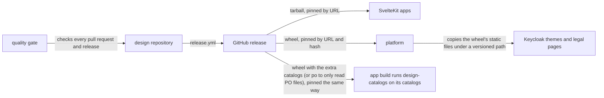
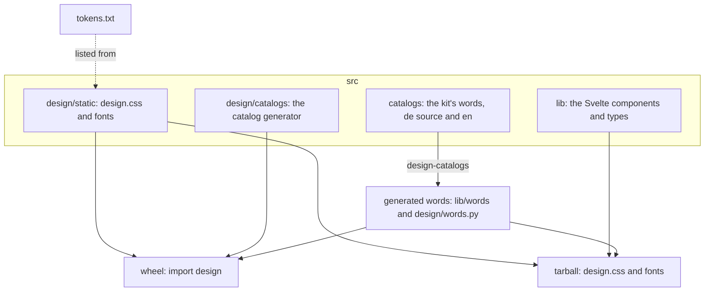
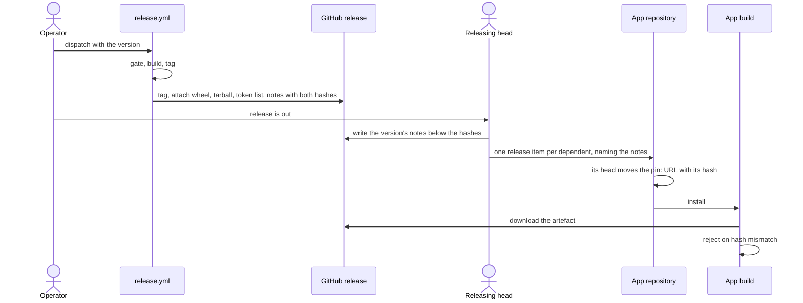

# design architecture

## 1. Context and Scope

design is the family look that overnightworks products share: one stylesheet,
its fonts and the Svelte components the [README](../README.md#components) lists,
and the generator that turns an app's translation catalogs into modules. It runs
no service. Outside it: the product apps that load the stylesheet (and, for
SvelteKit apps, the components), the Keycloak themes and the legal pages, which
platform builds from the wheel's static files, the GitHub release that
distributes it, and the shared quality gate that checks every pull request and
every release. Page layout and product-specific JavaScript stay in the products.
`TurnOutcome` is generated from agents' release wheel, pinned by url and sha256 in
`scripts/agents_vocabulary_pin.toml`; CI fails when regenerating it changes the type.

## 2. Building Block View

One stylesheet source is packaged twice, so every consumer gets identical CSS
and fonts. The components exist only in the tarball.

- **Stylesheet and fonts** (`design.css`, [`stylesheet.md`](stylesheet.md)): the family
  tokens, the `@font-face` rules, the heading rule for `h1` and `h2` and the classes
  `as-typed`, `legal`, `sign-in-card` and `sign-in-action`.
- **Components** ([README](../README.md#components)): props and behaviour are the
  docstrings of [`src/lib/types.ts`](../src/lib/types.ts); the words and the facts
  beyond the types are in [`stylesheet.md`](stylesheet.md). The app passes the
  kit's words as the required prop `words`, loaded with `loadKitWords`; no
  component holds an English default or reads a language.
- **Catalog generator** (`design.catalogs`, [`languages.md`](languages.md)): the
  command `design-catalogs` reads an app's gettext catalogs and writes a typed
  TypeScript module per language and, if the app declares one, a Python module;
  `--check` fails on a broken catalog or a stale module. It is in the wheel only,
  behind the extra `catalogs` (which requires the extra `po`, Babel), and runs at
  build time, never in a server or a browser.
- **The kit's words** (`src/catalogs`): the catalogs are the one source of two
  outputs, `src/lib/words` for the tarball and `src/design/words.py` for the wheel,
  which the kit's own `design-catalogs` generates and `--check` gates in CI. The
  catalogs belong to neither `src/lib` nor `src/design` and ship in neither
  artefact. The package root and the export `overnightworks-design/words` offer
  the generated loader as `loadKitWords`, from one hand-written module of the kit;
  the export carries no component, so plain Node loads it, which the root with its
  `.svelte` files does not. The kit reads no language itself. The Python module is
  for an app's tests, not its server, and needs no Babel.
- **Wheel**: the stylesheet and fonts for consumers without a JavaScript bundler,
  the generator and the kit's Python words. It holds no `.svelte`.
- **Tarball**: the stylesheet, fonts, components and the kit's words, each
  language its own chunk; `svelte` is its only dependency, as a peer.
- **Token list**: the sorted custom-property names, from `scripts/list_tokens`.

## 3. Runtime View

The core flow is how one change reaches every app; the [release
step](../AGENTS.md) and what follows it are in `AGENTS.md`.

## 4. Deployment View

design itself is not deployed. A GitHub-hosted runner builds the artefacts from
the gated commit, and a GitHub release holds them. The consumers'
builds download them: platform copies the wheel's static files into the
Keycloak themes and the legal pages, and SvelteKit builds bundle the tarball's
stylesheet and components into the app. In the browser the result is static CSS,
fonts and component markup.

## 5. Crosscutting Concepts

**Trust.** design holds no secrets. What it ships is static CSS, fonts and Svelte
components. The app passes the signed-in person's name, account URL and failure
text in; the components render them and keep none. So the question is the supply
path. GitHub enforces immutable releases for the organization, so a release's tag
and assets cannot change. A consumer pins a URL together with its content hash:
the wheel's sha256 in the URL, the tarball's sha512 integrity in the consumer's
lockfile, which pnpm 12 requires of every URL tarball entry and enforces at
every install, frozen or not. A release is built only from a commit that passed
quality's release gate, with no cache read, by a workflow whose actions are pinned
to commits and whose only write grant is the tag job's. The
[residuals of that path](https://github.com/overnightworks/quality/blob/main/docs/release.md#residual)
are quality's to name.

**Trust of the generator.** It runs in an app's build on that app's own committed
catalogs, which are as trusted as its code, and reads no network and no secret.
A catalog text is quoted into the modules (a JSON string in TypeScript, `repr` in
Python), so no text can leave its literal; the page owns every element and target.

**Ownership of the components.** A component owns its markup and look; a look that a page without Svelte also draws is a documented class in design.css, which the component applies. The app
owns what needs a decision about its product: routes, the trigger and popover,
storing the theme and setting `data-theme`, how logging out works, how a sign-in
starts, wording of failures, legal link targets, the app colour and loading
`design.css`. The components store, fetch and close nothing and write no
`data-theme`.

**Proof strategy.** CI runs `svelte-check` and vitest for the components, pytest
for the wheel, the tarball and the generator, with 100 % branch coverage of
`src/design`, and ruff. The generated TypeScript is run in Node and type-checked,
the generated Python is imported and passed through ruff, and the pin by hash is
proven by installing the built wheel through a URL with a wrong sha256, which
fails. The release gate and a check of the built file list guard `release.yml`.
Two Playwright consumers are built for production from the packed tarball and
paint the page in a browser, and the same consumers gate accessibility: axe
checks every variant of every part, and a token page of the colour pairs
`docs/stylesheet.md` promises, in both themes against WCAG 2.2 AA with no rule
disabled, so a part that fails it turns CI red. The components' branches are
measured on the browser compile, over both layers: Vitest's `client` project
counts them with Istanbul, and the consumer build the browser tests drive
carries Istanbul counters that each spec collects. The `server` project proves
the server render's behaviour and is not counted.
`coverage:merge` remaps the browser counters onto `src/lib`, merges both reports
with `nyc` into the `lcov.info` the quality gate reads and fails when the merged
report holds less than 100 % of the branches (nyc's default 90 % line threshold
also applies). Both layers see one branch once: `nyc` remaps with the same
library Vitest remaps with (a pnpm override), and the `client` project compiles
the components for production like the consumer build, so the unit layer tests
the compile the browser runs. The merge keys a branch by its first arm, so a
remapper that drops arms would let one report's shape cut the other's hits, and
two entries that share a first arm collide; the total check catches that.
`coverage:merge` also fails when the merged report counts fewer branches, or
fewer covered branches, than the client report, or when the lockfile holds two
source-map remappers. It compares numbers and cannot see one arm traded for
another at equal counts. An `{#if}` whose test is a bare prop or derived value
has no client entry in any report, because the compiler's source map has no
segment for it. Only the consumer's copy of the kit
carries counters; the tarball and the wheel are built without them. A `.ts`
module of `src/lib` is measured by Vitest alone, because the tarball ships it
transpiled without a source map; none has a branch today. The shared quality gate adds the secret scan, the
workflow-security scan and SonarCloud for CSS, HTML, Python and TypeScript.

## 6. Constraints and reasons

- The stylesheet and fonts exist once and are packaged in both forms, so no app
  sees a different look from its packaging.
- A broken release gets the next patch tag; releases are immutable.
- `release.yml` builds everything before it tags, so a failed build leaves
  nothing to undo.

## 7. Not chosen

- A custom element, or pages the kit renders on the server, instead of Svelte
  components: every app is on one stack, SvelteKit, and non-Svelte consumers (the
  Keycloak themes and the legal pages) take only the stylesheet. Reopens if an app
  that cannot run Svelte needs a component.
- Each consumer keeping its own copy of a shared rule set, such as the legal row's
  CSS: copies drift. Reopens only if a consumer cannot load `design.css`.
- A template fragment the kit ships for one provider (a Keycloak FTL or HTML
  fragment): it carries one provider's template format and still needs the rules
  in the stylesheet, so such a page writes the documented markup. Reopens if
  several consumers share one template format.
- The generator as a script in the npm tarball: it would carry Python inside an
  npm package, so every app would declare Babel itself and the copies would drift.
  Reopens only if an app cannot install the wheel in its build.
- Babel as a plain dependency of the wheel: its locale data would reach every
  app that takes the wheel for its static files.
- Babel's catalog update, and a hash of the source text, for freshness: the update
  matches entries by text across keys and drops plural categories the source lacks.
  A translation is current when its `msgid` equals the source's text for its key.
- Every language bundled in the components behind a `language` prop, an optional
  `words` prop with an English default, a Svelte context and a component that
  loads its own words: each ships every language or shows one on another's page,
  and hides where the app's language is decided, which the app owns (LANG-17).
- The app's generator merging the kit's words from the installed wheel into the
  app's modules: it couples an app build to the wheel version and makes the
  generator a precondition for taking the kit.
- Git pins (`github:overnightworks/design#vX.Y.Z`) instead of release assets for
  the npm package and the wheel as a runtime dependency: a git pin loses the
  content hash a consumer's lock checks. Reopens if a git pin can carry a checked
  content hash. The generator, a dev dependency, may be taken by git tag, which
  `uv lock` records as a commit.

## 8. Risks and Technical Debt

- SonarCloud does not analyse `.svelte` files; the checks above and the gate's
  size ratchet cover them.
